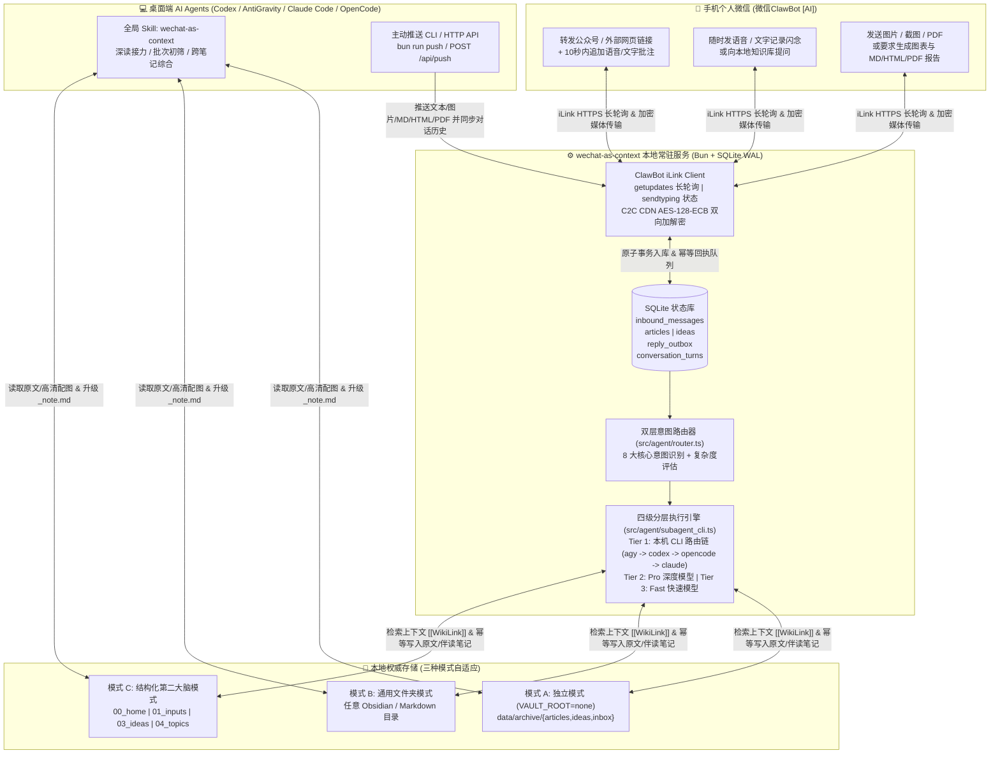

# WeChat as Context (`wechat-as-context`)

[](https://bun.sh)
[](https://www.typescriptlang.org/)
[](./docs/ilink_protocol_and_extension_guide.md)
[](./LICENSE)

> **把手机微信里的「高频阅读、语音批注与随时闪念」，变成个人知识库与桌面 AI 智能体（Codex / AntiGravity / Claude Code / OpenCode）可随时调用的活上下文（Living Context）。**

`wechat-as-context` 不是又一个孤立的「稍后读」收藏夹。它通过微信官方 **ClawBot iLink 长轮询协议**，将你个人微信置顶的 **`微信ClawBot [AI]`** 变成连接手机端与本地电脑的**双向智能体上下文网关**：

- 📱 **在手机微信端**：顺手转发公众号文章或外部网页、追加语音/文字批注、记录灵感闪念、发送截图/PDF、向本地知识库提问、或遥控本机 AI Agent（`agy` / `codex` / `opencode` / `claude`）执行深度研究并回传 `.md` / `.html` / `.pdf` 文件或架构配图。
- 💻 **在电脑桌面端**：在 Codex、AntiGravity、Claude Code、OpenCode 中一句指令即可接力深读刚转发的文章，或通过 `bun run push` 将桌面端产出的报告、图表、文档主动推送到手机微信，且自动注入微信对话上下文，手机端直接回复即可无缝追问。

---

## 📑 目录

- [核心特性](#-核心特性)
- [系统架构与工作流](#-系统架构与工作流)
- [三种知识库存储模式](#-三种知识库存储模式)
- [5 分钟快速开始](#-5-分钟快速开始)
- [手机微信端 8 大交互场景](#-手机微信端-8-大交互场景)
- [电脑端 AI Agent 协同与主动推送 (`push`)](#-电脑端-ai-agent-协同与主动推送-push)
- [可视化配置工作台 (Web Config Studio)](#-可视化配置工作台-web-config-studio)
- [CLI 命令行参考](#-cli-命令行参考)
- [本地 HTTP API 接口](#-本地-http-api-接口)
- [环境变量说明 (`.env`)](#-环境变量说明-env)
- [可靠性与权威存储保障 (Authoritative Storage)](#-可靠性与权威存储保障-authoritative-storage)
- [测试与开发](#-测试与开发)
- [许可证](#-许可证)

---

## ✨ 核心特性

- **🔌 零公网 IP、零反向代理、扫码即用**
  基于微信官方 iLink Bot 协议（`https://ilinkai.weixin.qq.com`）出站长轮询（`getupdates`），无需公网服务器、无需内网穿透、无需申请企业微信或公众号后台密钥。终端运行 `bun run login` 用个人微信扫码即可完成绑定。
- **🧠 两阶段阅读闭环 + 10 秒批注合并窗口**
  转发公众号或外部网页链接后，系统开启可配置的批注等待窗口（默认 `10s`），自动将你紧接着发出的语音（自动提取微信原生语音转写 `voice_item.text`）或文字思考与文章合并：
  - **第一阶段（手机端 10 秒异步初筛）**：净化提取公众号 `#js_content` 正文、自动下载防盗链高清图片至本地 `assets/`、结合你的本地知识库（`now.md`、已有主题笔记与闪念）生成双文件（`<slug>.md` 原文存档 + `<slug>_note.md` 伴读笔记），并在微信回推 **150 字结构化初筛卡**（`💡 为什么值得深读` / `⏭️ 为什么可略读` / `🔥 关联你的动态`）。
  - **第二阶段（电脑端或微信追问深读）**：对某篇文章感兴趣时，可在微信直接「引用回复」该回执追问，或在电脑端对 AI Agent 说 *“深度阅读刚才转发的公众号文章”*，直接将伴读笔记升级为 `reading_status: deep`。
- **⚡ 四级智能体分层路由链（Router $\rightarrow$ Local CLI $\rightarrow$ Pro $\rightarrow$ Fast）**
  1. **轻量意图路由 (`fastModel`)**：毫秒级识别入站消息意图、槽位参数与任务复杂度（`fast` / `deep`）。
  2. **Tier 1 本机 AI Agent CLI 路由链**：支持自动扫描并按自定义优先级调度本机安装的 `agy` (AntiGravity)、`codex`、`opencode`、`claude` (Claude Code)、`gemini`、`workbuddy` 及自定义 CLI 工具，直接共享本地文件系统与联网/绘图能力。
  3. **Tier 2 深度模型 (`proModel`)**：当本地 CLI 未启用或不可用时，复杂任务自动交由高阶推理模型（如 `gemini-2.5-pro` / `deepseek-reasoner` / `claude-opus-4-6`）执行。
  4. **Tier 3 快速模型兜底 (`fastModel`)**：当高阶模型限流或超时，自动无缝降级至快速模型（如 `gemini-2.5-flash` / `deepseek-chat`）并具备本地启发式兜底，确保 100% 响应。
- **🔐 微信 C2C 媒体双向 `AES-128-ECB` 加解密与多格式文档投递**
  完整实现微信 iLink CDN 媒体加解密协议（兼容 16 字节原始密钥与 32 字符 Hex ASCII 双编码格式）：
  - **入站**：手机微信发送截图、照片、PDF、文档，自动解密归档并调用多模态视觉模型提取要点；
  - **出站**：支持将知识库笔记或即时生成的报告一键渲染导出为 **Markdown (`.md`) + 现代排版网页 (`.html`) + 印刷级矢量 PDF (`.pdf`)**，加密上传后直接发回你的手机微信聊天框。
- **⏳ 长耗时任务实时心跳播报与并发进度查询**
  当本机 Agent 执行耗时较长的深度调研或长文生成时，微信端自动维护「对方正在输入...」状态（`sendtyping`），每隔固定周期主动推送阶段性进展心跳，且支持随时发送 *“还在跑吗”*、*“进度”* 立即查看已运行耗时与当前阶段，绝不阻塞新消息。

---

## 🏗 系统架构与工作流



---

## 🗂 三种知识库存储模式

本项目**不强制绑定任何特定目录结构**，支持根据你的使用习惯自由选择三种模式（可在 Web 配置工作台中一键切换）：

| 模式 | 配置方式 | 适用人群与行为说明 |
| :--- | :--- | :--- |
| **1. 无知识库独立模式 (`standalone`)** | `VAULT_ROOT=none`（或 `VAULT_ENABLED=false`） | **零外部依赖开箱即用**：无需 Obsidian 或外部知识库。所有抓取的文章、图片、闪念与收件箱自动归档在项目本地 `data/archive/{articles,web,ideas,inbox,papers}/` 下，手机微信端与 CLI 的全部功能 100% 可用。 |
| **2. 通用文件夹模式 (`generic_folder`)** | `VAULT_ROOT=/path/to/any/folder` | **适配任意现有 Obsidian 库或普通笔记目录**：无需 `00_home`、`01_inputs` 等编号子目录。系统直接在你指定的文件夹下按需检索 `.md` 上下文，不会强行改写你原有的目录结构。 |
| **3. 结构化知识库模式 (`structured_vault`)** | `VAULT_ROOT=./vault`（或指向含编号体系的知识库） | **深度第二大脑工作流**：支持 `00_home/now.md`（近期主线）、`01_inputs/articles/{wechat,web}/`、`01_inputs/inbox/`、`03_ideas/seeds/`、`04_topics/`、`05_outputs/` 等分层结构，自动提取近期关注主题词并生成双向 `[[WikiLink]]` 关联。 |

---

## 🚀 5 分钟快速开始

### 前置要求

- **操作系统**：macOS 或 Linux（Windows 可通过 WSL2 运行）
- **运行时**：[Bun](https://bun.sh) `>= 1.1.0`
  ```bash
  curl -fsSL https://bun.sh/install | bash
  ```

### 第一步：克隆仓库与一键初始化

```bash
git clone https://github.com/dqrcsc/wechat-as-context.git
cd wechat-as-context
bun install

# 一键初始化：自动生成 .env、按需初始化目录、安装全局 Agent Skill、扫描本机 CLI 并打开可视化配置台
bun run setup
```

> 💡 如果在无图形界面的服务器或终端环境下运行，可使用 `bun run setup -- --no-open` 仅在命令行完成初始化。

### 第二步：扫码绑定个人微信 `微信ClawBot [AI]`

```bash
bun run login
```

终端会直接渲染二维码，打开**手机个人微信扫一扫**确认授权：
- 凭据会自动安全保存在本地 `data/clawbot_state.json`（已列入 `.gitignore`）；
- 你的微信聊天列表中会出现置顶的 **`微信ClawBot [AI]`** 对话框。

### 第三步：自检并启动常驻服务

```bash
# 检查知识库模式、LLM API 连通性、本机 CLI 路由链与微信绑定状态
bun run doctor

# 前台启动服务（默认监听 127.0.0.1:8787 并开启微信长轮询）
bun run start
```

如果你使用的是 **macOS**，推荐一键安装为系统级 `launchd` 开机自启后台守护进程（崩溃自动拉起）：

```bash
bash scripts/install_daemon.sh
```

---

## 📱 手机微信端 8 大交互场景

绑定完成后，直接打开手机微信里的 **`微信ClawBot [AI]`** 即可使用以下全部能力（处理期间微信顶部会实时显示 **「对方正在输入...」**）：

### 1. 转发公众号或外部网页 + 语音/文字批注 (`ingest_link`)
- **操作**：在微信看到好文章 $\rightarrow$ 转发给 `微信ClawBot [AI]`（支持 `mp.weixin.qq.com` 公众号链接，以及 ArXiv、Substack、技术博客、X/Twitter 等任意外部网页 URL）$\rightarrow$ **10 秒内可紧接着发一条语音或文字批注**（如 *“这篇文章对 Agent 记忆架构的拆解很值得参考”*）。
- **效果**：
  1. 自动清洗广告与无关脚本，将正文与全部防盗链图片下载至本地 `<slug>.md` 及 `assets/`；
  2. 将你的语音/文字批注置顶写入 `<slug>_note.md` 的 `## 我的转发批注`；
  3. 结合你的本地知识库上下文，在微信回复一张 **150 字高信息密度初筛卡**（含文章编号 `#N`、核心论点、为什么值得深读/可略读、与你当前研究的关联点）。

### 2. 随时语音/文字记录灵感闪念 (`capture_idea`)
- **操作**：直接发送自然语言灵感（如 *“我突然想到可以用知识图谱约束 Agent 的长程状态漂移”*）或带前缀（`💡 ...`、`想法：...`）。
- **效果**：自动提取标题、标签与关联文章，生成独立 Markdown 种子文件存入 `03_ideas/seeds/`（或独立模式下的 `data/archive/ideas/`），绝不相互覆盖。

### 3. 快速碎片备忘归档 (`capture_inbox`)
- **操作**：发送 `记录：...`、`备忘：...` 或转发无链接纯文本片段。
- **效果**：自动归档至 `01_inputs/inbox/` 并返回入库确认。

### 4. 手机微信直接检索个人知识库与联网问答 (`vault_query`)
- **操作**：直接用自然语言提问，例如：
  - *“我之前关于本体论与上下文工程的笔记写到哪了？”*
  - *“帮我结合知识库和最新网页搜索，对比一下 GraphRAG 和 LLM Wiki 的优劣”*
- **效果**：自动穿透检索本地知识库相关笔记与 SQLite 文章索引，按需触发实时联网搜索（Google Search Grounding / Web Search），返回带 `[[WikiLink]]` 真实笔记引用的深度解答。

### 5. 微信「引用消息」精准追问与笔记升级 (`article_followup`)
- **操作**：在微信中**长按引用**之前的某条文章初筛回执（支持微信原生“引用部分文字” `partial_text`），或发送 *“详细拆解一下第 #12 篇的实验部分”*。
- **效果**：精准定位对应文章本地原文与你的知识库笔记进行深度解答，并将该文章的 `_note.md` 升级补充。

### 6. 发送图片/截图/PDF 自动解密入库与视觉解析 (`multimodal_ingest`)
- **操作**：在微信里直接发送白板照片、论文截图、架构图或 PDF 文档（可附带指令）。
- **效果**：自动通过 `AES-128-ECB` 解密微信 CDN 媒体文件，归档至本地 `assets/` 或 `papers/`，并调用多模态视觉模型提取图文要点回传微信。

### 7. 多格式报告生成与文件直传微信 (`send_file` & `doc_exporter`)
- **操作**：在微信里发送：
  - *“把刚才那篇公众号文章的原件发给我”*
  - *“帮我整理一份个人知识库新手构建指南，生成 md、html 和 pdf 三种格式的文件发给我”*
- **效果**：内置文档排版引擎（[`src/agent/doc_exporter.ts`](./src/agent/doc_exporter.ts)）自动将 Markdown 渲染为带完整 CSS 样式的独立 `.html` 与印刷级 `.pdf`（自动调用本机 Headless Chrome / Edge / wkhtmltopdf 或内嵌 CJK 矢量 PDF 引擎），加密上传后直接作为微信原生文件卡片发回你的手机！

### 8. 遥控本机 AI Agent CLI 绘图与深度委托 (`generate_image` / `delegate_subagent`)
- **操作**：
  - *“帮我画一张知识工程三层架构图发给我”*
  - *“让 codex 帮我扫描整理一下知识库最近的闪念种子”*
- **效果**：自动唤醒本机配置的 CLI 路由链（如 `agy` / `codex` / `opencode` / `claude`），生成的 PNG/JPG 图片或新建的笔记文件会自动加密回传至手机微信。

---

## 💻 电脑端 AI Agent 协同与主动推送 (`push`)

### 1. 全局 Skill 自动集成 (`wechat-as-context`)
运行 `bun run setup` 时，系统会自动将 [`skills/wechat-as-context/SKILL.md`](./skills/wechat-as-context/SKILL.md) 软链接至 `~/.codex/skills/wechat-as-context`。
当你在桌面端使用 **Codex / AntiGravity / Claude Code / OpenCode** 时，可以直接对 Agent 说：
- *“看看我今天在微信转发了哪些公众号文章，帮我做个主题汇总”*
- *“深度精读第 #3 篇公众号文章，结合我知识库里的笔记更新 `_note.md`”*

### 2. 电脑端主动推送到手机微信 (`bun run push` / `POST /api/push`)
任何桌面端脚本或 AI Agent 都可以随时把消息、图片或文档主动推向你的手机微信，并**自动写入 `conversation_turns` 对话上下文**（你在手机微信收到后直接打字回复，Agent 就能认出你在回复刚才推送的内容）：

```bash
# 1. 主动推送一条文本汇报到手机微信
bun run push -- "已完成今日 5 篇论文综述，核心结论已写入 04_topics/"

# 2. 将一份本地 Markdown 笔记同时渲染为 .md + .html + .pdf 三种格式发到手机微信
bun run push -- "这是刚整理好的架构设计文档，请查收" --doc ./vault/05_outputs/arch_guide.md --formats md,html,pdf

# 3. 推送本地图片或任意附件到手机微信
bun run push -- "最新实验结果对比图" --image ./charts/benchmark.png
```

---

## 🎛 可视化配置工作台 (Web Config Studio)

无需手改复杂的环境变量，随时运行以下命令即可在浏览器打开本地可视化配置工作台（默认 `http://127.0.0.1:8787/config`）：

```bash
bun run config
```

Web 配置工作台支持：
- **多供应商模型池管理**：内置 Google Gemini、DeepSeek、OpenCode Go / Zen、OpenAI、OpenRouter、阿里云百炼 (DashScope)、SiliconFlow、Moonshot (Kimi)、智谱 GLM、Anthropic Claude 及自定义 OpenAI 兼容端点预设，自动检测本机已有环境变量（如 `GEMINI_API_KEY`、`DEEPSEEK_API_KEY`、`OPENCODE_API_KEY`、`OPENAI_API_KEY`）。
- **跨供应商 Fast / Pro 模型混搭**：例如使用 `deepseek::deepseek-chat` 作为极速路由模型，同时使用 `gemini::gemini-2.5-pro` 作为深度分析模型。
- **一键真实连通性测试**：在页面上直接点击「⚡ 测试模型连通性」，实时验证 API Key 与模型响应延迟。
- **本机 AI Agent CLI 自动探测与拖拽排序**：一键扫描本机安装的 `agy`、`codex`、`opencode`、`claude`、`gemini`、`workbuddy` 等 CLI 可执行文件路径，自由勾选并调整 Tier 1 降级路由顺序，或添加自定义 CLI 模板（支持 `{{prompt}}`、`{{model}}`、`{{workdir}}` 占位符）。
- **系统原生文件夹选择器 & 一键安全补全子目录**：点击「📂 选择文件夹」直接唤起 macOS Finder / 系统文件夹选择窗口；点击「✨ 一键安全补全缺失子目录」仅创建缺失目录，**承诺绝不覆盖或修改任何已有笔记文件**。

---

## 🛠 CLI 命令行参考

你可以通过 `bun run src/cli.ts <command>`（或全局链接后的 `wx-ctx <command>`）执行以下操作：

| 命令 | 示例 | 功能说明 |
| :--- | :--- | :--- |
| `init` / `setup` | `bun run setup` | 一键初始化 `.env`、按需创建目录、安装全局 Skill、扫描本机 CLI 并打开配置网页（加 `--no-open` 可跳过打开浏览器） |
| `config` | `bun run config` | 启动并打开本地可视化配置工作台 (`http://127.0.0.1:8787/config`) |
| `scan-cli` | `bun run scan-cli` | 扫描本机已安装的 AI Agent CLI 工具并显示当前 Tier 1 路由链（支持 `--json`） |
| `login` | `bun run login` | 在终端生成微信 iLink 授权二维码，手机微信扫码绑定 `微信ClawBot [AI]` |
| `doctor` | `bun run doctor` | 全面诊断知识库状态、LLM 配置、SQLite 队列计数与微信绑定状态（支持 `--json`） |
| `list` | `bun run src/cli.ts list --status light` | 列出已抓取的文章列表（支持 `--status raw\|light\|deep\|skipped` 与 `--limit N`） |
| `show` | `bun run src/cli.ts show 1` | 查看指定文章 `#ID` 的元数据、伴读笔记与原文片段（加 `--full` 输出完整正文） |
| `ingest` | `bun run src/cli.ts ingest "https://mp.weixin.qq.com/s/..." --note "批注"` | 从命令行直接抓取一篇公众号文章并生成伴读笔记与微信回执 |
| `sync` | `bun run src/cli.ts sync` | 手动触发一次微信入站消息拉取、队列处理与回执发送 |
| `push` | `bun run push -- "消息内容" --doc ./note.md --formats md,html,pdf` | 从电脑端主动向手机微信推送文本、图片 (`--image`)、文件 (`--file`) 或多格式渲染文档 (`--doc`) |
| `triage` | `bun run src/cli.ts triage 1 deep` | 显式更新指定文章 `#ID` 的阅读状态（`raw` \| `light` \| `deep` \| `archived` \| `skipped`），仅修改 YAML frontmatter |
| `idea` | `bun run src/cli.ts idea "我的新想法" --article 1` | 从命令行快速记录一条个人闪念种子（可选关联某篇文章 `#ID`） |

---

## 🌐 本地 HTTP API 接口

常驻服务默认仅绑定回环地址 `127.0.0.1:8787`，并内置严格的 **Host Header 校验与跨源 (`Origin`) 拦截保护**，防止浏览器 DNS Rebinding 或跨站请求伪造（CSRF）攻击。

| 方法与路径 | 说明 |
| :--- | :--- |
| `GET /health` | 返回服务健康状态、统计计数、知识库模式与微信配置状态 |
| `GET /config` | 打开可视化 Web 配置工作台页面 |
| `GET /api/config` | 获取脱敏后的当前配置、已配置模型供应商列表、子目录状态与本机 CLI 扫描结果 |
| `POST /api/config` | 更新 `.env` 配置项并立即在内存热重载生效（自动保留 `.env` 原有注释与排版） |
| `POST /api/config/test-llm` | 实时测试指定模型供应商与 Model ID 的 API 连通性及响应耗时 |
| `GET /api/config/scan-cli` | 实时重新扫描本机已安装的 AI Agent CLI 工具 |
| `POST /api/ingest` | 提交公众号链接抓取任务：`{"url": "https://mp.weixin.qq.com/s/...", "annotation": "可选批注"}` |
| `POST /api/push` | 主动向手机微信推送消息与多格式文件：`{"text": "...", "docPath": "...", "exportFormats": ["md","html","pdf"]}` |
| `POST /api/sync` | 立即触发队列消费与微信回执冲刷 |
| `GET /api/articles` | 获取近期归档文章列表（支持 `?status=light&limit=20`） |
| `GET /api/ideas` | 获取近期捕获的个人闪念列表 |

---

## ⚙️ 环境变量说明 (`.env`)

复制 [`.env.example`](./.env.example) 为 `.env`（或直接运行 `bun run config` 在网页界面配置）：

```ini
# 1. LLM API 配置（支持 gemini | deepseek | opencode | openai | openrouter | dashscope | siliconflow | moonshot | zhipu | anthropic | custom）
LLM_PROVIDER=gemini
LLM_API_KEY=
LLM_BASE_URL=https://generativelanguage.googleapis.com/v1beta/openai
LLM_MODEL=gemini-2.5-flash
LLM_FAST_MODEL=gemini-2.5-flash
LLM_PRO_MODEL=gemini-2.5-pro

# 2. 本机 AI Agent CLI 路由链配置（Tier 1 本地子智能体优先级顺序）
CLI_ROUTING_CHAIN=agy,codex,opencode,claude,workbuddy
CUSTOM_CLI_AGENTS=[]
ALLOW_CODEX_FALLBACK=true

# 3. 本地服务与知识库模式
PORT=8787
ANNOTATION_WAIT_SECONDS=10
# 填 `none` 开启无知识库独立模式；填任意路径指向 Obsidian 库或结构化知识库
VAULT_ROOT=./vault

# 4. 可选：外部通知 Webhook（支持飞书 / 钉钉 / 通用 JSON Webhook）
NOTIFY_WEBHOOK_URL=
NOTIFY_ON_EVENTS=article,idea,plan
```

---

## 🛡️ 可靠性与权威存储保障 (Authoritative Storage)

本项目针对个人知识库场景设计了严格的工程安全边界（详见 [`tests/reliability.test.ts`](./tests/reliability.test.ts)）：

1. **绝不静默覆盖人工笔记**：
   - 原文存档（`<slug>.md`）与伴读笔记（`<slug>_note.md`）落盘采用独占原子写入（`wx` + `.tmp` rename）；
   - 一旦文件已存在（尤其是你已经手动编辑或升级为 `deep` 状态的笔记），后台自动任务或重复转发**绝不覆盖已有正文分毫**；
   - `triage` 状态变更仅精确替换 YAML Frontmatter 中的 `reading_status` 与 `triaged_at` 字段，100% 保留正文全部字节。
2. **同日同名中文标题防碰撞**：
   - 当不同文章清洗后的 Slug 相同时，自动追加确定性 URL 短哈希后缀（如 `2026_10_22_人工智能综述_a1b2c3.md`），彻底杜绝覆盖。
3. **原子游标推进与跨进程写锁**：
   - 微信 `getupdates` 批次消息入库与游标 `get_updates_buf` 更新在同一 SQLite 事务中原子提交；
   - 内置 `runtime_locks` 跨进程租约锁，防止后台守护进程与手动 CLI 命令并发处理同一任务。
4. **有界幂等回执队列 (`reply_outbox`)**：
   - 微信回执发送使用确定性 `client_id` 幂等重试（最多 3 次）；若最后一次尝试因网络中断状态未知，标记为 `uncertain` 告警而非无限死循环重发。

---

## 🧪 测试与开发

项目配备完整的单元测试与端到端可靠性测试套件（覆盖 AES-128-ECB 双格式加解密、iLink 消息解包、四级模型降级链路、Web 配置工作台 API、多格式文档渲染导出、并发锁与崩溃恢复等 40 项测试）：

```bash
# 运行全部单元与可靠性测试
bun test

# 运行 TypeScript 严格类型检查
bun run typecheck

# 开发模式启动（代码变更自动热重载）
bun run dev
```

更多关于微信 iLink 协议细节与架构扩展的说明，请参考：
- 📄 [微信 ClawBot iLink 协议机制与扩展指南 (`docs/ilink_protocol_and_extension_guide.md`)](./docs/ilink_protocol_and_extension_guide.md)
- 🧩 [桌面端 AI Agent 协同 Skill 定义 (`skills/wechat-as-context/SKILL.md`)](./skills/wechat-as-context/SKILL.md)

---

## 📄 许可证

本项目基于 [MIT License](./LICENSE) 开源。
